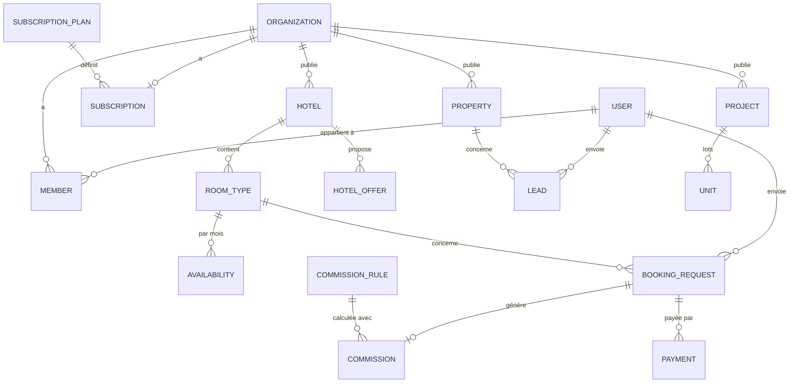

# ZAKA — Plan de conception

> Flutter (mobile + web) · Firebase · Google Cloud
> Basé sur le cahier des charges corrigé (novembre 2026) · Mis à jour le 20/11/2026 avec les décisions de l'équipe

Ce qu'il faut créer concrètement (comptes, projets, services) est listé dans [MISE_EN_PLACE.md](MISE_EN_PLACE.md).
Les textes des CGU et de la politique de confidentialité sont dans [CGU_ET_CONFIDENTIALITE.txt](CGU_ET_CONFIDENTIALITE.txt).

---

## 1. Décisions validées

| Sujet | Décision |
|---|---|
| Zone de lancement | **UEMOA**, ouverte aux 8 pays dès le lancement : Bénin, Burkina Faso, Côte d'Ivoire, Guinée-Bissau, Mali, Niger, Sénégal, Togo. **Marché prioritaire : Burkina Faso** (pays par défaut, villes du Burkina en tête du catalogue, carte centrée sur Ouagadougou) |
| Devise | **XOF uniquement**. Montants stockés en **entiers** (le XOF n'a pas de centimes), toujours avec le code devise |
| Langue | Français au lancement. Le code est prêt pour l'i18n (fichiers `.arb`) |
| Plateformes | Une seule base Flutter : **Android** et **Web** (site public + espace pro). Le back-office admin est une **cible web séparée** du même code. **iOS est écarté pour le moment** : les utilisateurs d'iPhone passent par le site web |
| Vérification des comptes pros (hôtels, agences, promoteurs) | Pièces exigées : **IFU**, **RCCM**, **contrat de bail ou autre justificatif de résidence**. Le compte est vérifié une fois, puis le pro publie librement. L'admin modère après coup (signalements) |
| Particuliers propriétaires | **Aucun document officiel** demandé, seulement un numéro de téléphone vérifié par SMS. En contrepartie, **chaque annonce est validée par ZAKA** dans l'admin avant d'être visible |
| Réservation hôtel | Demande soumise à confirmation. **Elle expire après 48 h** sans réponse de l'hôtel |
| Commission hôtelière | Due **après le séjour** (statut `completed`) |
| Conservation des données | **Tout est conservé**, sauf quand un utilisateur demande la suppression de ses données personnelles. Dans ce cas, ses données personnelles sont effacées et ses transactions sont anonymisées (elles restent utiles à la comptabilité des commissions) |
| Litiges | **ZAKA n'est pas responsable** des litiges entre clients et partenaires. Son seul rôle : **fournir les informations utiles** au règlement (historique, messages, dates). À écrire dans les CGU |
| Commissions et abonnements | **Modifiables depuis l'interface admin**. Aucun taux codé en dur |
| Paiement | Prestataire retenu : **CinetPay**. Au MVP, les paiements sont **simulés** : le parcours existe, mais aucun argent ne circule |
| Achat échelonné et investissement participatif | **En stand-by**. Le modèle de données est réservé (section 4.6), mais rien n'est développé pour le moment |
| Région Firebase / GCP | **`europe-west1`** (Belgique), confirmée |
| Recherche | Filtres **Firestore** avec index composés au MVP. Algolia ou Typesense plus tard si besoin |

---

## 2. Architecture

Il n'y a **pas de serveur classique** à maintenir : le « serveur » est constitué des **Cloud Functions**, et Firebase gère l'hébergement, la base de données et l'authentification.

```
┌──────────────────────────────────────────────────────────────┐
│                 Application Flutter (1 code)                 │
│  Android · Web public + espace pro · Web admin               │
└──────────────┬───────────────────────────────┬───────────────┘
               │ SDK Firebase                  │ HTTPS (callable)
┌──────────────▼──────────────┐   ┌────────────▼───────────────┐
│ Firebase                    │   │ Cloud Functions (2nd gen)  │
│ • Auth (téléphone, e-mail,  │◄──┤ TypeScript, europe-west1   │
│   Google)                   │   │ • logique métier sensible  │
│ • Firestore (données)       │   │ • changements de statut    │
│ • Storage (photos, pièces)  │   │ • commissions, paiements   │
│ • FCM (notifications push)  │   │   (simulés puis CinetPay)  │
│ • App Check · Remote Config │   │ • notifications, audit     │
│ • Crashlytics · Analytics   │   │ • tâches planifiées        │
│ • Hosting (2 sites web)     │   │                            │
└──────────────┬──────────────┘   └────────────┬───────────────┘
               │                               │
┌──────────────▼───────────────────────────────▼───────────────┐
│ Google Cloud                                                 │
│ Secret Manager · Cloud Scheduler · Sauvegardes Firestore     │
│ BigQuery (statistiques) · Cloud Logging / Monitoring         │
│ Alertes de budget                                            │
└──────────────────────────────────────────────────────────────┘
   Services externes : e-mail (Brevo), CinetPay (phase 6),
   SMS / WhatsApp (plus tard)
```

### Choix techniques

| Couche | Choix | Pourquoi |
|---|---|---|
| State management | **Riverpod** | Testable, adapté à une architecture par modules |
| Navigation | **go_router** | Gère les URL web et les redirections selon le rôle |
| Modèles | **freezed** + **json_serializable** | Modèles immuables, sérialisation Firestore fiable |
| Géolocalisation | **geohash** (`geoflutterfire_plus`) | Recherche « autour de moi » sur Firestore |
| Images | Extension **Resize Images** | Miniatures automatiques, utiles sur les connexions mobiles lentes |
| E-mails | Extension **Trigger Email** + Brevo | Notifications de demandes |
| Feature flags | **Remote Config** | Activer un module ou le paiement réel sans republier l'app |
| Paiement | Interface `PaymentGateway` côté Functions | `SimulatedGateway` au MVP, puis `CinetPayGateway` : on change d'implémentation sans toucher l'app |

### Environnements

Trois projets Firebase : `zaka-dev`, `zaka-staging`, `zaka-prod`. Dans Flutter, ils correspondent aux flavors `dev`, `staging` et `prod`.

### Structure du code Flutter (par fonctionnalité)

```
lib/
├── main.dart            # app publique + espace pro (mobile et web)
├── main_admin.dart      # back-office admin (web uniquement)
├── app/                 # router, thème, flavors, i18n
├── core/                # widgets communs, Money, dates, erreurs
└── features/
    ├── auth/            # connexion, inscription, OTP
    ├── account/         # profil, favoris, notifications
    ├── organizations/   # compte pro, membres, vérification
    ├── billing/         # abonnements, commissions, paiements simulés
    ├── hotels/          # fiche hôtel, chambres, offres, disponibilités
    ├── bookings/        # demandes de réservation
    ├── properties/      # biens immobiliers
    ├── projects/        # programmes immobiliers
    ├── leads/           # demandes de contact / visite
    ├── moderation/      # signalements
    └── admin/           # écrans du back-office
    chaque feature : data/ (repositories) · domain/ (modèles) · presentation/ (écrans)
```

---

## 3. Rôles et permissions

| Rôle | Comment il est attribué | Peut faire |
|---|---|---|
| **Visiteur** | Non connecté | Rechercher, consulter les fiches publiées |
| **Client** | Tout utilisateur connecté | Envoyer des demandes, suivre ses demandes, gérer ses favoris, signaler une annonce |
| **Membre pro** | Document `organizations/{orgId}/members/{uid}` (rôle `owner` ou `editor`) | Gérer les annonces et les demandes **de son organisation uniquement**. Pro vérifié : publication directe. Particulier : chaque annonce passe par la validation ZAKA |
| **Modérateur** | Custom claim `role: moderator` | Vérifier les comptes pros, **valider les annonces des particuliers**, traiter les signalements, suspendre une annonce, exporter un dossier pour un litige, traiter les demandes de suppression de données |
| **Admin** | Custom claim `role: admin` | Tout ce que fait le modérateur, plus les rôles, catalogues, **commissions, abonnements**, statistiques et configuration |

Une même personne peut être client et membre d'une ou plusieurs organisations.

### Règles de sécurité (principes)

- Lecture publique **uniquement** des annonces au statut `published`.
- Écriture sur une annonce : réservée aux membres de l'organisation propriétaire, et seulement si l'organisation a le statut `verified`.
- Une organisation en mode `review` (particulier) ne peut **jamais** passer elle-même une annonce en `published` : elle la soumet (`pending_review`), et seule une Cloud Function appelée par un modérateur la publie. Toute modification d'une annonce déjà publiée la renvoie en validation.
- Les champs sensibles ne s'écrivent **que** depuis les Cloud Functions : statut de vérification, paiements, commissions, abonnements, journal d'audit, compteurs.
- Les changements de statut d'une demande (accepter, refuser) passent par une **fonction callable**, qui vérifie la transition et écrit dans le journal d'audit.
- Storage : photos d'annonces en lecture publique. **Pièces justificatives (IFU, RCCM, bail) en accès privé** : le propriétaire du compte et les modérateurs seulement.
- App Check est activé sur Firestore, Storage et Functions.
- Firebase Auth : l'envoi de SMS est **limité aux indicatifs UEMOA** (+221, +223, +225, +226, +227, +228, +229, +245) pour limiter la fraude et les coûts.

---

## 4. Modèle de données (Firestore)

### Vue d'ensemble



> **Conventions**
> - `Money` = `{ amount: int, currency: "XOF" }`
> - Toutes les dates sont des `Timestamp`
> - Chaque document a `createdAt` et `updatedAt`
> - Les champs marqués 🔒 sont écrits uniquement par les Cloud Functions

### 4.1 Comptes et organisations

**`users/{uid}`**
| Champ | Type | Note |
|---|---|---|
| displayName, email, phone, photoUrl | string | |
| country | string | code pays UEMOA (`BF` par défaut, `CI`, `SN`…) |
| locale | string | `fr` |
| orgIds | string[] | 🔒 organisations dont l'utilisateur est membre |
| fcmTokens | string[] | appareils pour les notifications push |
| status | enum | `active` · `suspended` 🔒 |
| staffRole | string? | 🔒 copie lisible du custom claim (`admin` · `moderator`), pour lister l'équipe |

- `users/{uid}/favorites/{targetId}` → `{ targetType: hotel|property|project, addedAt }`
- `users/{uid}/notifications/{id}` → `{ title, body, link, read }`

**`organizations/{orgId}`** : un compte pro. Un particulier propriétaire a aussi sa propre organisation, ce qui garde un modèle unique pour tous les publieurs.
| Champ | Type | Note |
|---|---|---|
| type | enum | `hotel` · `individual_owner` · `agency` · `developer` |
| name, description, logoUrl | string | |
| contact | map | téléphone, e-mail, adresse, ville, pays |
| legal | map | `{ ifuNumber, rccmNumber, representativeName }` |
| verification.status | enum | 🔒 `draft` · `pending` · `verified` · `rejected` · `suspended` |
| verification.documents | map | `{ ifu, rccm, proofOfAddress }` : chemins Storage privés (vide pour un particulier) |
| verification.submittedAt / reviewedBy / reviewedAt / note | | 🔒 |
| createdBy | string | 🔒 uid du créateur |
| publishingMode | enum | 🔒 `direct` (pro vérifié) · `review` (particulier : chaque annonce est validée) |
| subscriptionId | string? | 🔒 abonnement en cours |

- `organizations/{orgId}/members/{uid}` → `{ role: owner|editor, addedAt }`

**Cycle de vérification**
- **Pro** (hôtel, agence, promoteur) : `draft` (pièces en cours d'envoi) → `pending` (dossier complet) → `verified` ou `rejected` (avec motif). `publishingMode = direct`.
- **Particulier** : vérifié automatiquement dès que son téléphone est confirmé, sans document. `publishingMode = review`. Un particulier ne peut publier que des biens immobiliers (pas d'hôtel ni de programme).
- Dans les deux cas, l'admin peut passer un compte en `suspended`.

### 4.2 Commissions, abonnements et paiements (paramétrables par l'admin)

**`commissionRules/{ruleId}`** : définies et modifiées dans le back-office
| Champ | Type | Note |
|---|---|---|
| scope | enum | `hotel_booking` · `property_rent` · `property_sale` |
| rateType | enum | `percent` · `fixed` |
| rate / fixedAmount | number / Money | |
| orgId | string? | vide = règle par défaut, rempli = règle propre à un partenaire |
| validFrom, validTo | Timestamp | permet de changer un taux sans toucher au passé |
| active | bool | |
| updatedBy | string | admin auteur du changement (aussi tracé dans `auditLogs`) |

**`commissions/{id}`** 🔒 : le registre des commissions dues
| Champ | Type | Note |
|---|---|---|
| orgId | string | |
| source | map | `{ type: bookingRequest, id }` |
| baseAmount, amount | Money | |
| ruleSnapshot | map | **copie de la règle appliquée** : un changement de taux ne modifie pas les commissions passées |
| status | enum | `due` · `invoiced` · `paid` · `waived` |

**`subscriptionPlans/{planId}`** : créés et modifiés dans le back-office
| Champ | Type |
|---|---|
| name, description | string |
| price | Money |
| period | `month` · `year` |
| target | `hotel` · `real_estate` · `all` |
| features | map `{ maxListings, featuredListings, advancedStats }` |
| active | bool |

Un plan **« Gratuit »** (identifiant `free`, créé par `npm run seed-billing`) s'applique à tout compte sans abonnement payant en cours : il reste à 0 FCFA, actif et ouvert à tous.

**`subscriptions/{id}`** 🔒 → `{ orgId, orgName, planId, planSnapshot, status: active|expired|cancelled, currentPeriodStart, currentPeriodEnd, lastPaymentId, renewalReminderSentAt, replacedBy }`

Règles des abonnements (phase 2) :
- seul un **propriétaire** d'un compte **vérifié** souscrit, à un plan qui correspond à son type de compte ;
- le montant vient toujours du plan enregistré, jamais de l'app, et l'abonnement garde une copie du plan payé (`planSnapshot`) ;
- **pas de renouvellement automatique** : chaque période est payée. Repayer le même plan prolonge la période en cours ; choisir un autre plan remplace l'abonnement tout de suite, sans remboursement au prorata ;
- la tâche quotidienne `expireSubscriptions` prévient les propriétaires **7 jours** avant la fin, puis repasse le compte au plan Gratuit à l'échéance.

Règles des commissions (phase 2) :
- la règle propre au partenaire passe avant la règle par défaut ; si plusieurs règles sont en vigueur, la plus récente (date de début la plus tardive) l'emporte. Un nouveau taux se programme donc en créant une règle avec sa date de début ;
- la date de fin d'une règle est exclue ; le pourcentage est arrondi au franc près ;
- registre : `due` → `invoiced` → `paid`, ou `waived` (offerte, avec motif). `paid` et `waived` sont définitifs ; une facture peut être annulée (`invoiced` → `due`).

**`payments/{id}`** 🔒
| Champ | Type | Note |
|---|---|---|
| provider | enum | `simulation` (MVP) · `cinetpay` (phase 6) |
| purpose | map | `{ type: subscription, planId, subscriptionId }` ; en phase 3 : `{ type: booking, bookingRequestId }` |
| payerUid / payerOrgId / orgName | string | lisible par le payeur, les membres du compte payeur et l'équipe |
| planSnapshot | map | plan payé, appliqué tel quel à la confirmation |
| amount | Money | |
| status | enum | `pending` · `succeeded` · `failed` · `cancelled` |
| providerRef | string? | identifiant de transaction CinetPay (plus tard) |
| simulatedOutcome | enum? | `success` · `failure`, choisi dans l'écran de simulation |

En mode simulation, l'app affiche un écran de paiement factice avec un bandeau **« Mode test : aucun paiement réel »**. Le passage à CinetPay se fait par Remote Config (`payments.provider`).

### 4.3 Hôtellerie

**`hotels/{hotelId}`**
| Champ | Type | Note |
|---|---|---|
| orgId | string | organisation propriétaire |
| name, description | string | |
| address, city, district, country | string | `city` vient du catalogue |
| geo | map | `{ geohash, lat, lng }` |
| photos | string[] | ordonnées, la première sert de couverture |
| amenities | string[] | codes du catalogue (wifi, piscine…) |
| stars | int? | |
| rules | map | heures d'arrivée et de départ, animaux, politique d'annulation **de l'hôtel** |
| minPricePerNight | Money | 🔒 dénormalisé depuis les chambres, sert aux filtres |
| featured | bool | 🔒 mise en avant selon l'abonnement |
| status | enum | `draft` · `published` · `inactive` · `suspended` (le dernier est 🔒, posé par l'admin) |

**`hotels/{hotelId}/roomTypes/{roomTypeId}`**
| Champ | Type |
|---|---|
| name, description | string |
| capacityAdults, capacityChildren | int |
| beds | string |
| pricePerNight | Money |
| quantity | int (nombre de chambres de ce type) |
| photos, amenities | string[] |
| active | bool |

**`hotels/{hotelId}/roomTypes/{roomTypeId}/availability/{yyyy-MM}`**
`{ days: { "01": 3, "02": 0, … } }` : nombre de chambres déclarées disponibles par jour. Il n'y a **pas de synchronisation temps réel** avec l'hôtel, donc la demande reste toujours « soumise à confirmation ».

**`hotels/{hotelId}/offers/{offerId}`**
`{ title, description, discountPercent | specialPrice, roomTypeIds[], validFrom, validTo, active }`

**`bookingRequests/{requestId}`**
| Champ | Type | Note |
|---|---|---|
| hotelId, orgId, roomTypeId, offerId? | string | |
| clientUid | string | |
| clientSnapshot | map | nom et téléphone figés au moment de la demande |
| checkIn, checkOut | Timestamp | |
| adults, children, rooms | int | |
| estimatedTotal | Money | estimation affichée au client |
| message | string | |
| status | enum | voir le cycle de vie ci-dessous 🔒 |
| expiresAt | Timestamp | 🔒 `createdAt + 48 h` |
| paymentStatus | enum | 🔒 `unpaid` · `paid_simulated` · `paid` |
| statusHistory | array | 🔒 `{ status, by, at, note }` |

- `bookingRequests/{id}/messages/{msgId}` → `{ fromUid, text, at }` : échanges de précisions entre le client et l'hôtel.

**Cycle de vie d'une demande de réservation**
```
pending ──► accepted ──► completed  (→ commission calculée)
   │  ▲         └──────► cancelled
   │  └── info_requested (l'hôtel demande des précisions, le client répond)
   ├──► rejected
   ├──► cancelled (par le client)
   └──► expired (aucune réponse 48 h après la création)
```
Une fois la demande `accepted`, le client peut payer en ligne (simulé au MVP) ou payer à l'hôtel.

### 4.4 Immobilier

**`properties/{propertyId}`**
| Champ | Type | Note |
|---|---|---|
| orgId | string | |
| transactionType | enum | `rent` · `sale` |
| propertyType | enum | `apartment` · `house` · `villa` · `land` · `office` · `shop` · `room` |
| title, description | string | |
| city, district, country, geo | | même format que pour les hôtels |
| price | Money | |
| rentPeriod | enum? | `month` · `day` (location) |
| surface, rooms, bedrooms, bathrooms | int | |
| features | string[] | meublé, parking, gardien… |
| conditions | map | caution, avance de loyer, frais d'agence… |
| photos | string[] | |
| projectId?, unitId? | string | si le bien est un lot d'un programme |
| featured | bool | 🔒 |
| status | enum | `draft` · `pending_review` · `published` · `rejected` · `under_offer` · `rented` · `sold` · `inactive` · `suspended` |
| moderation | map | 🔒 `{ reviewedBy, reviewedAt, reason }` : renseigné pour les annonces de particuliers |

**Cycle d'une annonce de particulier**
```
draft ──► pending_review ──► published ──► rented / sold / inactive
                 │                │
                 └──► rejected    └── modification ──► pending_review
                      (motif, corrigeable puis resoumise)
```
Pour un pro vérifié, l'annonce passe directement de `draft` à `published`.

**`projects/{projectId}`** : programme immobilier d'un promoteur
| Champ | Type |
|---|---|
| orgId, title, description | string |
| city, district, country, geo | |
| estimatedBudget | Money |
| timeline | array `{ label, date, done }` |
| documents | string[] (plaquette, plans) |
| status | `draft` · `published` · `in_progress` · `delivered` · `inactive` · `suspended` |

- `projects/{projectId}/units/{unitId}` → `{ label, propertyType, surface, rooms, price: Money, status: available|reserved|sold }`

**`leads/{leadId}`** : demande de contact, de visite ou d'information
| Champ | Type |
|---|---|
| type | `contact` · `visit` · `info` |
| targetType / targetId | `property` · `project` / id |
| orgId, clientUid, clientSnapshot | |
| message, preferredDates | |
| status | `new` · `in_progress` · `visit_scheduled` · `closed` |

- `leads/{leadId}/messages/{msgId}` : même format que pour les réservations.

### 4.5 Transverse

| Collection | Contenu |
|---|---|
| `reports/{id}` | Signalements : `{ targetType, targetId, reporterUid, reason, status: open|resolved|dismissed }` |
| `catalog/cities`, `catalog/amenities`, `catalog/propertyTypes` | Listes de référence gérées par l'admin (villes des 8 pays UEMOA, Burkina Faso en tête) |
| `deletionRequests/{id}` | Demandes de suppression de données : `{ uid, requestedAt, status: pending|done|refused, processedBy, processedAt, note }` 🔒 pour tout sauf la création |
| `auditLogs/{id}` | 🔒 `{ actorUid, action, targetRef, before, after, at }` pour les opérations sensibles, y compris chaque modification de commission ou d'abonnement |
| `disputeExports/{id}` | 🔒 trace des exports de dossier faits pour un litige : `{ requestedBy, targetRef, reason, fileUrl, at }` |
| `config/app` | Version minimale de l'app, messages d'information, durée d'expiration des demandes (`bookingExpiryHours: 48`) |

### 4.6 Modules en stand-by (réservés, non développés)

L'achat échelonné et l'investissement participatif restent dans la vision du produit. Les noms de collections sont **réservés** pour ne pas créer de conflit plus tard. Rien n'est codé tant que l'équipe ne relance pas ces modules et que le cadre juridique n'est pas validé.

| Collection réservée | Rôle prévu |
|---|---|
| `installmentOffers` | Conditions d'achat échelonné proposées par un pro, validées par l'admin |
| `installmentContracts` (+ `installments`) | Dossier client et échéancier, avec une distinction nette entre simulation, intérêt et engagement signé |
| `investmentCampaigns` (+ `updates`) | Campagne de financement participatif d'un programme |
| `investments` | Participation d'un utilisateur à une campagne |

Le détail des champs figure dans la version précédente du plan et sera repris à la relance du module.

### Index composés à prévoir (exemples)

- `hotels` : `status + city + minPricePerNight`
- `properties` : `status + transactionType + city + price`
- `properties` : `status + transactionType + propertyType + city + price`
- `bookingRequests` : `orgId + status + createdAt` (espace hôtel), `clientUid + createdAt` (espace client), `status + expiresAt` (expiration)
- `leads` : `orgId + status + createdAt` et `clientUid + createdAt`
- `commissions` : `orgId + status + createdAt`

---

## 5. Fonctionnalités par espace

### 5.1 Visiteur / Client
| Fonctionnalité | MVP |
|---|:-:|
| Inscription et connexion (téléphone OTP, e-mail, Google) | ✅ |
| Recherche d'hôtels : ville, dates, personnes, prix, équipements | ✅ |
| Recherche de biens : location/vente, type, ville/quartier, budget, pièces | ✅ |
| Fiches détaillées (hôtel, bien, programme) avec galerie et carte | ✅ |
| Demande de réservation hôtel, avec le délai de réponse de 48 h affiché | ✅ |
| Paiement en ligne d'une réservation acceptée (**simulé**) | ✅ |
| Demande de contact, de visite ou d'information sur un bien | ✅ |
| Suivi des demandes et messagerie avec le pro | ✅ |
| Favoris | ✅ |
| Notifications push et e-mail | ✅ |
| Signaler une annonce | ✅ |
| Supprimer son compte et demander l'effacement de ses données personnelles (exigé aussi par Google Play) | ✅ |
| Paiement réel via CinetPay | Phase 6 |

### 5.2 Espace Hôtel
| Fonctionnalité | MVP |
|---|:-:|
| Créer le compte pro et déposer IFU, RCCM et justificatif de résidence | ✅ |
| Gérer les membres (owner, editor) | ✅ |
| Fiche hôtel : infos, photos, équipements, règles | ✅ |
| Types de chambres : prix, capacité, photos, activer/désactiver | ✅ |
| Offres spéciales | ✅ |
| Calendrier des disponibilités déclarées | ✅ |
| Recevoir les demandes : accepter, refuser, demander des précisions (avec un rappel avant l'expiration à 48 h) | ✅ |
| Choisir un abonnement (paiement **simulé**) | ✅ |
| Voir ses commissions dues | ✅ |
| Historique et statistiques de base (vues, demandes, taux d'acceptation) | ✅ |

### 5.3 Espace Immobilier (propriétaire, agence, promoteur)
| Fonctionnalité | MVP |
|---|:-:|
| Agence ou promoteur : compte pro et vérification (IFU, RCCM, justificatif de résidence) | ✅ |
| Particulier : inscription sans document, téléphone vérifié | ✅ |
| Publier, modifier et changer le statut des biens (loué, vendu…) | ✅ |
| Particulier : suivre la validation de ses annonces (en attente, publiée, refusée avec motif) | ✅ |
| Programmes immobiliers et leurs lots (promoteur) | ✅ |
| Gérer les demandes de contact et de visite | ✅ |
| Choisir un abonnement (paiement **simulé**) | ✅ |
| Statistiques de base par annonce | ✅ |
| Achat échelonné, investissement participatif | Stand-by |

### 5.4 Administration ZAKA (Flutter Web, site séparé)
| Fonctionnalité | MVP |
|---|:-:|
| File de vérification des comptes pros : consulter les pièces, valider, refuser avec motif, suspendre | ✅ |
| **File de validation des annonces des particuliers** : publier ou refuser avec motif | ✅ |
| Traitement des demandes de suppression de données | ✅ |
| Traitement des signalements, suspension d'annonces | ✅ |
| Gestion des utilisateurs et des rôles | ✅ |
| **Commissions** : créer et modifier les règles (taux par défaut et par partenaire, dates de validité) | ✅ |
| **Abonnements** : créer et modifier les plans, voir les abonnements actifs | ✅ |
| Registre des commissions dues par partenaire | ✅ |
| **Export du dossier d'une demande** (historique, messages, dates) pour un litige | ✅ |
| Catalogues : villes, équipements, types de biens | ✅ |
| Tableau de bord : comptes, annonces, demandes, commissions | ✅ |
| Journal d'activité (audit) | ✅ |

---

## 6. Cloud Functions prévues

| Fonction | Déclencheur | Rôle |
|---|---|---|
| `onUserCreated` | Auth | Crée `users/{uid}` |
| `submitOrgVerification` | Callable | Vérifie que les 3 pièces sont présentes, passe le compte en `pending`, alerte les modérateurs |
| `reviewOrg` | Callable (modérateur) | Valide ou refuse le compte, notifie le pro, écrit l'audit |
| `createOrganization` | Callable | Crée l'espace d'un pro (`draft`) ou d'un particulier (téléphone vérifié obligatoire, vérifié d'office, mode `review`) |
| `addOrgMember` / `removeOrgMember` | Callable (propriétaire) | Gère les membres d'un compte pro ; le dernier propriétaire ne peut pas être retiré |
| `syncProfileFromAuth` | Callable | Recopie dans le profil le téléphone et l'e-mail vérifiés par Firebase Auth |
| `submitListingForReview` / `reviewListing` | Callable | Le particulier soumet son annonce ; le modérateur la publie ou la refuse avec motif. Notification et audit |
| `setUserRole` | Callable (admin) | Pose les custom claims |
| `createBookingRequest` | Callable | Valide les dates et la capacité, calcule l'estimation, fixe `expiresAt` à +48 h, notifie l'hôtel |
| `updateBookingStatus` | Callable | Vérifie la transition et les droits, notifie le client, écrit l'audit |
| `remindPendingRequests` | Planifiée (toutes les heures) | Rappelle l'hôtel quand il reste moins de 12 h pour répondre |
| `expirePendingRequests` | Planifiée (toutes les 15 min) | Passe en `expired` les demandes dont `expiresAt` est dépassé, notifie le client |
| `onBookingCompleted` | Firestore | Calcule la commission avec la règle active et enregistre une copie de la règle |
| `startPayment` | Callable | Crée le `payment` via `PaymentGateway` (simulation au MVP) |
| `confirmSimulatedPayment` | Callable | Clôture un paiement simulé (succès, échec ou annulation) et met à jour la réservation ou l'abonnement |
| `upsertCommissionRule` / `upsertSubscriptionPlan` | Callable (admin) | Enregistre la modification et écrit l'audit |
| `previewCommission` | Callable (équipe) | Simulateur du back-office : règle appliquée et montant, avec le calcul des vraies commissions |
| `updateCommissionStatus` | Callable (admin) | Registre : facturer, encaisser ou offrir des commissions (100 par appel), avec audit |
| `exportDisputeFile` | Callable (modérateur) | Génère un PDF ou JSON du dossier, le stocke en privé, trace l'export |
| `onRoomTypeWrite` | Firestore | Recalcule `minPricePerNight` de l'hôtel |
| `onLeadCreated` / `onMessageCreated` | Firestore | Notifie l'autre partie (push + e-mail) |
| `onReportCreated` | Firestore | Alerte les modérateurs |
| `processDataDeletion` | Callable (modérateur) | Efface le profil, les photos et le compte Auth ; remplace les données personnelles dans les demandes et messages par « Utilisateur supprimé » ; garde les montants pour la comptabilité |
| `expireSubscriptions` | Planifiée (chaque jour, 3 h) | Prévient 7 jours avant la fin, puis repasse au plan Gratuit les abonnements échus |
| `dailyStats` | Planifiée (chaque nuit) | Agrège les statistiques, export BigQuery |
| `cinetpayWebhook` | HTTPS | Retour de paiement CinetPay (phase 6) |

---

## 7. Exigences transverses

| Exigence | Mise en œuvre |
|---|---|
| Mobile-first, connexions lentes | Miniatures d'images, pagination (20 éléments), cache Firestore hors-ligne, `cached_network_image` |
| Sécurité | Règles Firestore et Storage testées avec l'émulateur, App Check, secrets dans Secret Manager |
| Pièces justificatives | Bucket privé, accès par URL signée de courte durée côté admin |
| Litiges | Messages et historiques conservés, export de dossier tracé, clause de non-responsabilité dans les CGU |
| Données personnelles | Conservation illimitée par défaut. Suppression sur demande via `deletionRequests` (anonymisation des transactions) |
| Sauvegardes | Point-in-time recovery Firestore et sauvegardes planifiées quotidiennes (rétention de 30 jours) |
| Journalisation | `auditLogs`, Cloud Logging, Crashlytics |
| Coûts | Alertes de budget GCP, SMS limités aux pays UEMOA, lectures limitées par la pagination et la dénormalisation |
| Tests | Tests unitaires des repositories, widget tests des écrans clés, tests des règles avec l'émulateur, CI GitHub Actions |
| Documentation | README d'installation, procédure de sauvegarde et de restauration, comptes de test par rôle |

---

## 8. Découpage en phases

| Phase | Contenu | Livrable |
|---|---|---|
| **0. Setup** ✅ (déployée sur `zaka-dev-01`) | Comptes et projets ([MISE_EN_PLACE.md](MISE_EN_PLACE.md)), flavors, CI, structure du code, design system, i18n | App vide déployée en dev |
| **1. Socle** ✅ (déployée sur `zaka-dev-01`) | Auth, profils, organisations, vérification pro (IFU, RCCM, justificatif), comptes particuliers, rôles, catalogues, admin de base, signalements, suppression de compte. *La file de validation des annonces de particuliers arrive avec les annonces (phase 4)* | Un pro peut créer son compte et se faire valider |
| **2. Facturation (simulée)** ✅ (en local) | Plans d'abonnement et règles de commission éditables dans l'admin, paiement simulé, registre des commissions | L'admin pilote les tarifs sans développeur |
| **3. Hôtellerie** | Fiche hôtel, chambres, offres, disponibilités, recherche, demandes avec expiration à 48 h, paiement simulé, notifications | Parcours de réservation complet |
| **4. Immobilier** | Biens, programmes et lots, recherche, leads, visites, espace pro, validation des annonces de particuliers | Parcours immobilier complet |
| **5. Lancement MVP** | Tests utilisateurs, sécurité, sauvegardes, statistiques, mise en ligne des CGU et de la politique de confidentialité, publication sur les stores et le web | **Lancement MVP** (focus Burkina Faso) |
| **6. Paiements réels** | Intégration CinetPay (Mobile Money + carte), webhooks, rapprochement | Paiement réel activé par Remote Config |
| **Stand-by** | Achat échelonné, investissement participatif | À relancer après validation juridique |

Répartition suggérée : **William** prend l'architecture, les règles de sécurité, les Cloud Functions et les modèles. **Herman** prend les écrans et les parcours Flutter. Les deux se partagent la revue croisée et les tests.

---

## 9. Points restants

Toutes les décisions nécessaires au MVP sont prises. Il reste deux actions :

1. **Faire relire les CGU et la politique de confidentialité par un juriste** avant leur mise en ligne. Les champs entre crochets (raison sociale, adresse, RCCM, e-mail de contact) sont à compléter. *Avant la phase 5*
2. **Déclaration auprès de la CIL** (Commission de l'Informatique et des Libertés du Burkina Faso) : vérifier avec le juriste si le traitement des données de ZAKA doit être déclaré ou autorisé, notamment pour les pièces justificatives et l'hébergement hors du Burkina (Belgique). *Avant la phase 5*
